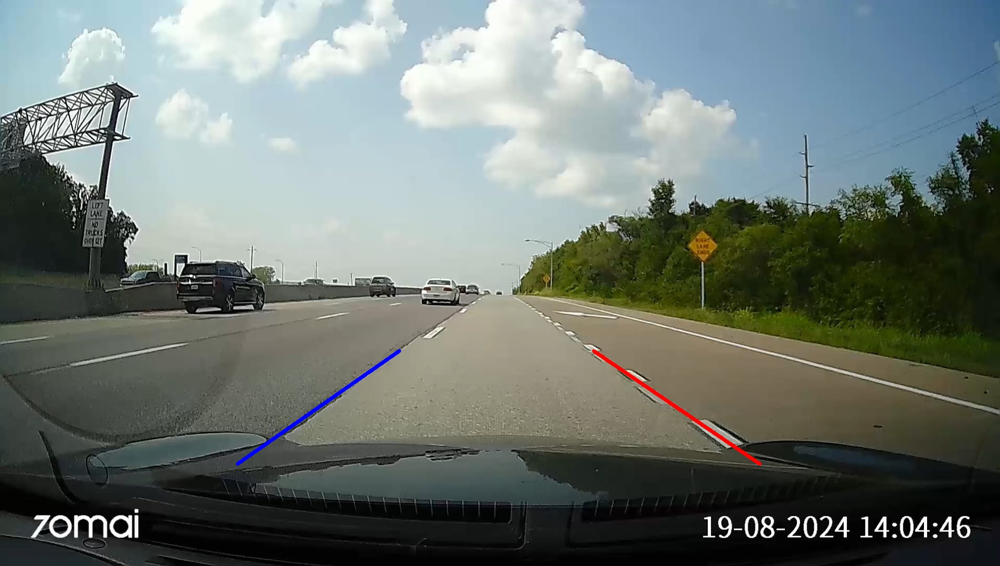
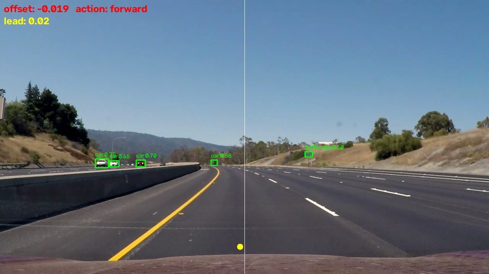
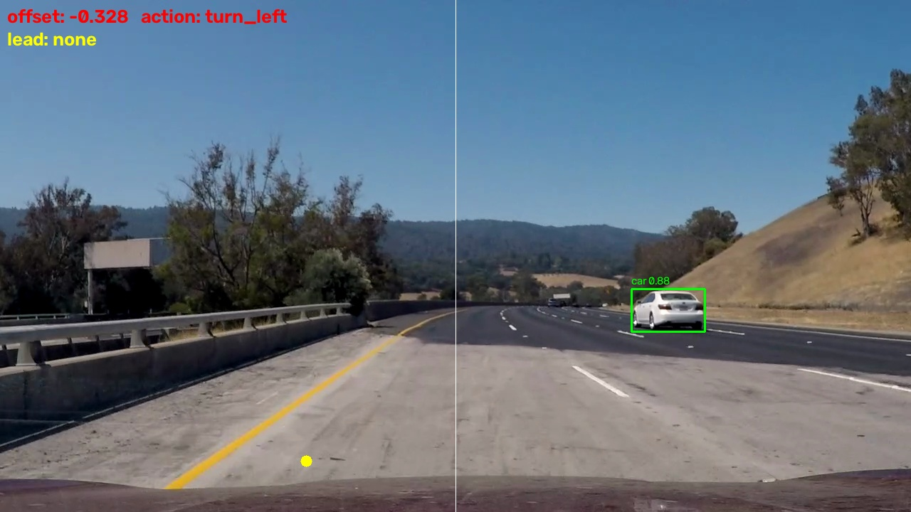

<a href="https://github.com/priom-mahatab/bumblebee"></a>

# Mini Autonomous Vehicle Using Computer Vision

[](https://www.python.org/)
[](https://opencv.org/)
[](https://github.com/ultralytics/ultralytics)
[](#)
[](#status)

**Mini Autonomous Vehicle** is a COSC 4358 course project: a small self-driving
car (Raspberry Pi, camera, motors, ultrasonic sensor) that combines classical
lane detection with a [YOLOv8](https://github.com/ultralytics/ultralytics)
object detector to navigate a controlled track — responding to lanes,
obstacles, and stop signs. Everything except the final motor actuation runs and
is testable on a laptop with just a webcam.



*The HUD `main.py` draws each frame: the signed lane offset, YOLO detection boxes, the lane-center marker (yellow) vs. frame center (white), and the resulting state-machine `action`.*

## Table of Contents

- [Status](#status)
- [How it works](#how-it-works)
- [Installation](#installation)
    - [Dev machine (laptop / Colab)](#dev-machine-laptop--colab)
    - [Raspberry Pi](#raspberry-pi)
- [Running it now (no hardware needed)](#running-it-now-no-hardware-needed)
- [Detection results](#detection-results)
- [Project layout](#project-layout)
- [License](#license)
- [Links](#links)

## Status

Hardware (Raspberry Pi, camera, motors, ultrasonic sensor) is under assembly. Until it
is ready, development is **hardware-independent**: the control logic, the
lane-detection algorithm, and object-detection inference all run and are
testable on a laptop. Hardware-touching code is isolated to
`control/motor_control.py` and `vision/camera.py`'s `PiCameraSource` so the rest
of the pipeline stays portable.

## How it works

The pipeline turns a single camera frame into one driving decision each tick:

- **Lane detection** (`vision/`) — classical OpenCV: color + edge masking, a
  region-of-interest crop, and a Hough-transform lane fit that yields a signed
  lane offset.
- **Object detection** (`detection/`) — YOLOv8n reads the same frame for
  `person`, `car`, `truck`, `bus`, and `stop sign`.
- **Decision logic** (`control/state_machine.py`) — pure, hardware-free state
  machine that fuses the lane offset, detections, and a distance reading into an
  `Action` (forward, slow, stop, steer, or lane-change). All tunable thresholds
  (stop/slow distance, lane deadzone, in-path bbox range) are module-level
  constants here, not hardcoded inline.



*Same HUD on a left curve: a lane offset of `-0.328` (lane-center marker pushed left of center) drives the state machine to a `turn_left` action.*

Object detection on the car uses **fine-tuned YOLOv8n on BDD100K merged with stop signs**.
Fine-tuning on BDD100K is a separate experiment (the graded mAP/IoU deliverable,
see [Detection results](#detection-results)).

## Installation

### Dev machine (laptop / Colab)

> **Note:** use Python 3.12 — the Homebrew python3.14 isn't reliable for the ML
> wheels (torch, ultralytics) yet.

```bash
python3.12 -m venv .cv
source .cv/bin/activate
pip install -r requirements.txt
```

### Raspberry Pi

On the Pi, install the dev requirements first, then the Pi-only extras:

```bash
pip install -r requirements.txt
pip install -r requirements-pi.txt
```

`requirements-pi.txt` lists the packages needed only on the Pi (`gpiozero`,
etc.). `picamera2` is **not** pip-installable — it goes in via `apt` on the Pi,
since it depends on the system libcamera libraries.

## Running it now (no hardware needed)

Quick self-tests for the hardware-independent pieces:

```bash
python -m control.state_machine   # decision logic against scripted scenarios
python -m sim.mock_inputs         # fake camera frame + distance readings
python -m vision.lane_detection   # lane-offset calc against a synthetic frame
```

Live object detection only, printed per frame:

```bash
python -m detection.infer
```

Full dry-run pipeline using your laptop's webcam (lane detection + object
detection + control decision, printed each frame, no motors):

```bash
python main.py
```

## Detection results

The fine-tuned detector is evaluated per the proposal's criteria — mAP@0.50
(primary), mAP@0.50:0.95, and precision/recall at IoU ≥ 0.50. Four YOLOv8n runs,
each changing essentially one variable, so the gains are attributable:

| Run | Classes | Train imgs | Epochs | imgsz | mAP@0.50 | mAP@0.50:0.95 | Precision | Recall |
|-----|---------|-----------|--------|-------|----------|---------------|-----------|--------|
| v1  | 5 (no stop sign) | 5 000  | 30 | 640 | 0.477 | 0.280 | 0.601 | 0.434 |
| v2  | 6 | 6 910  | 80 | 640 | 0.578 | 0.397 | 0.691 | 0.541 |
| v3  | 6 | 26 910 | 80 | 640 | 0.635 | 0.437 | 0.714 | 0.587 |
| **v4** | 6 | 26 910 | 80 | **960** | **0.701** | **0.468** | **0.764** | **0.635** |

v4 is the deployed model. Full per-class numbers, the step-by-step ablation, and
important caveats (notably the `traffic sign` vs `stop sign` label conflict) are
in [`eval/detection_metrics.md`](eval/detection_metrics.md). Reproduce with:

```bash
python -m eval.evaluate
```

## Project layout

- `hardware/` — bill of materials, pinout, wiring notes (no code)
- `vision/` — camera capture, preprocessing, lane detection
- `detection/` — YOLO inference now; BDD100K prep + fine-tuning later
- `control/` — `state_machine.py` (pure decision logic) and, once hardware
  arrives, `motor_control.py` (the only file that touches GPIO)
- `sim/` — mock frames/sensor readings for testing without hardware
- `eval/` — mAP/IoU/latency scripts and logged results
- `docs/` — proposal, final report, and demo materials
- `main.py` — ties the pipeline together

## License

Coursework for COSC 4358. No formal open-source license has been applied.

## Links

- [Ultralytics YOLOv8](https://github.com/ultralytics/ultralytics)
- [BDD100K dataset](https://www.vis.xyz/bdd100k/)
- [OpenCV](https://opencv.org/)
- [Lane-detection pipeline notes](docs/lane-detection-pipeline.md)
- [Detection evaluation](eval/detection_metrics.md)
