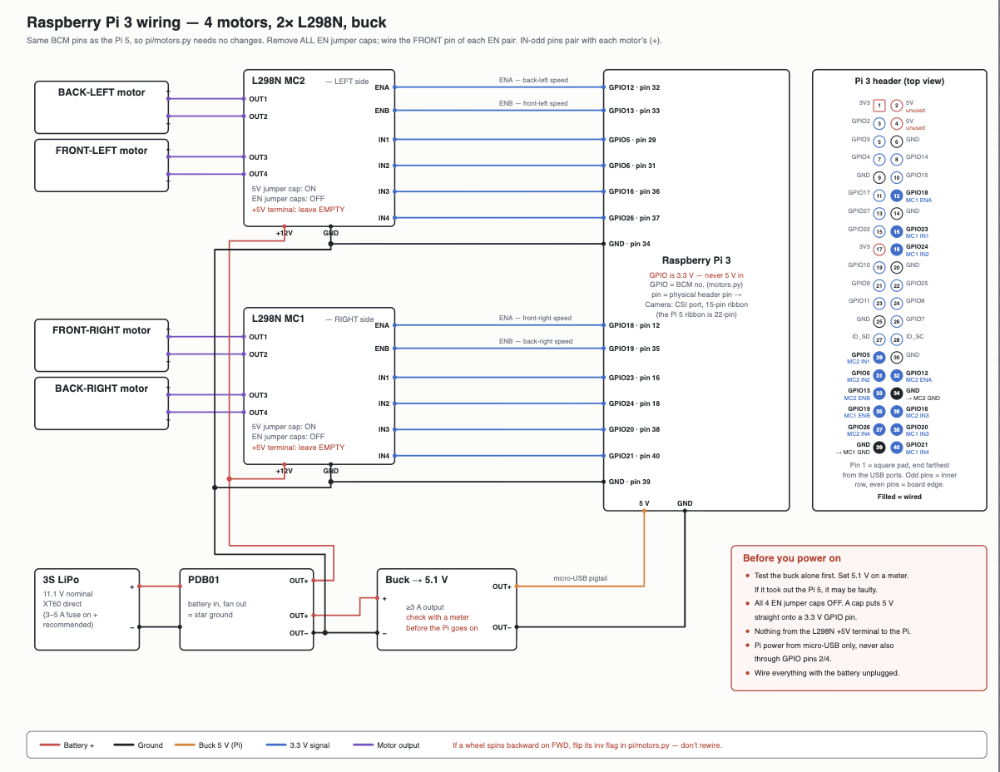

# Wiring & Pinout — Raspberry Pi 3

4 motors, 2× L298N, buck-powered Pi 3. Pins are the same BCM numbers as the Pi 5
build, so the motor code (`control/motor_control.py`, the only file that touches
GPIO) needs no pin changes between boards. `GPIO` below = **BCM** number;
`phys` = physical header pin.

**L298N jumpers:** 5 V jumper cap **ON**, all **EN jumper caps OFF** (wire the
front pin of each EN pair), and leave the **+5 V terminal EMPTY**. An EN cap
would put 5 V straight onto a 3.3 V GPIO pin.

## Motor pinout

Each motor uses one EN pin (PWM speed) + two IN pins (direction). IN-odd pins
pair with each motor's (+).

### Left side — L298N MC2

| Motor | Speed (EN) | Dir (IN) | Dir (IN) | L298N out |
|-------|-----------|----------|----------|-----------|
| Back-left  | GPIO12 · phys 32 (ENA) | GPIO5 · phys 29 (IN1) | GPIO6 · phys 31 (IN2) | OUT1/OUT2 |
| Front-left | GPIO13 · phys 33 (ENB) | GPIO16 · phys 36 (IN3) | GPIO26 · phys 37 (IN4) | OUT3/OUT4 |

MC2 logic GND → Pi **phys 34 (GND)**. MC2 +12 V → PDB01 battery rail.

### Right side — L298N MC1

| Motor | Speed (EN) | Dir (IN) | Dir (IN) | L298N out |
|-------|-----------|----------|----------|-----------|
| Front-right | GPIO18 · phys 12 (ENA) | GPIO23 · phys 16 (IN1) | GPIO24 · phys 18 (IN2) | OUT1/OUT2 |
| Back-right  | GPIO19 · phys 35 (ENB) | GPIO20 · phys 38 (IN3) | GPIO21 · phys 40 (IN4) | OUT3/OUT4 |

MC1 logic GND → Pi **phys 39 (GND)**. MC1 +12 V → PDB01 battery rail.

> If a wheel spins backward on FORWARD, flip its `inv` flag in the motor code —
> don't rewire.

## Ultrasonic sensor — HC-SR04 (not on the diagram yet)

The HC-SR04 isn't in the wiring diagram above; every pin there is used by the
motors. It still needs wiring:

- **Vcc → Pi 5 V** (phys pin 2 or 4). Sourcing 5 V *out* to the sensor is fine;
  the "never power through pins 2/4" rule is about feeding power *into* the Pi.
- **GND → any Pi GND**, common with the rest of the ground.
- **TRIG → a free GPIO** (3.3 V out is fine for TRIG).
- **ECHO → a free GPIO *through a voltage divider*.** ECHO idles at 5 V, which
  would damage the 3.3 V input — use ~1 kΩ (series) + ~2 kΩ (to GND), or
  equivalent, to drop it to ~3.3 V.

**TRIG / ECHO pins: TBD** — pick two of the unused GPIOs below and record them
here once wired. Free GPIOs on this build: GPIO4 (7), GPIO17 (11), GPIO27 (13),
GPIO22 (15), GPIO10 (19), GPIO9 (21), GPIO25 (22), GPIO11 (23), GPIO8 (24),
GPIO7 (26), plus GPIO2/3 (3/5, I²C) and GPIO14/15 (8/10, UART) if needed.

## Camera

Raspberry Pi Camera via the **CSI port**, 15-pin ribbon (the Pi 5 uses a 22-pin
ribbon — different cable).

## Safety checklist (before power-on)

- Wire everything with the **battery unplugged**.
- Test the buck alone first; set **5.1 V** on a meter before connecting the Pi.
- All **4 EN jumper caps OFF**.
- **Nothing** from the L298N +5 V terminal to the Pi.
- Pi power from the **micro-USB only**, never also through GPIO pins 2/4.
- GPIO is **3.3 V — never feed it 5 V** (hence the ECHO divider).
- 3–5 A inline fuse on the battery + lead.

## Pi 3 header reference (wired pins)

Pin 1 = square pad, farthest from the USB ports. Odd pins = inner row, even =
board edge.

| phys | BCM | use | | phys | BCM | use |
|-----|------|-----|---|-----|------|-----|
| 12 | GPIO18 | MC1 ENA | | 29 | GPIO5 | MC2 IN1 |
| 16 | GPIO23 | MC1 IN1 | | 31 | GPIO6 | MC2 IN2 |
| 18 | GPIO24 | MC1 IN2 | | 32 | GPIO12 | MC2 ENA |
| 35 | GPIO19 | MC1 ENB | | 33 | GPIO13 | MC2 ENB |
| 38 | GPIO20 | MC1 IN3 | | 36 | GPIO16 | MC2 IN3 |
| 40 | GPIO21 | MC1 IN4 | | 37 | GPIO26 | MC2 IN4 |
| 39 | GND | MC1 GND | | 34 | GND | MC2 GND |
